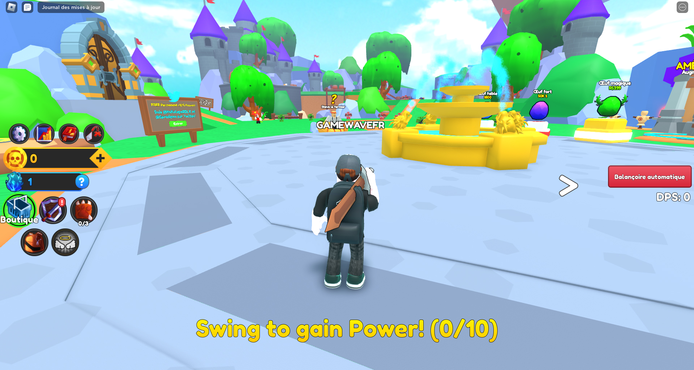
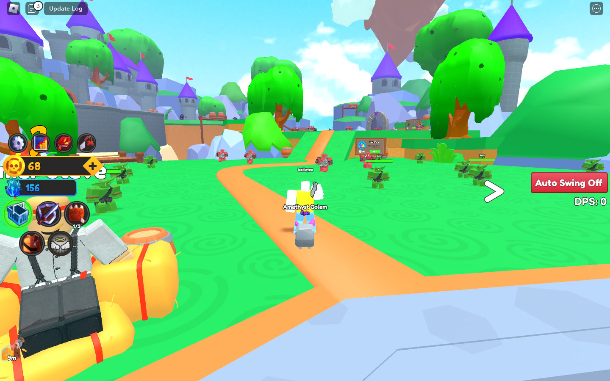
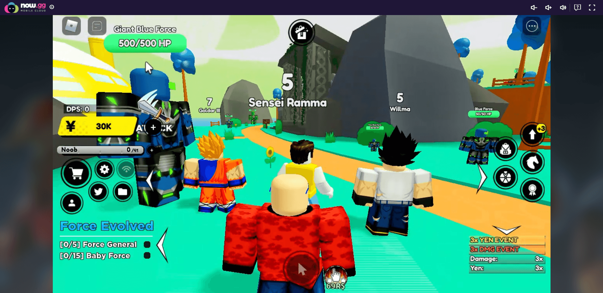
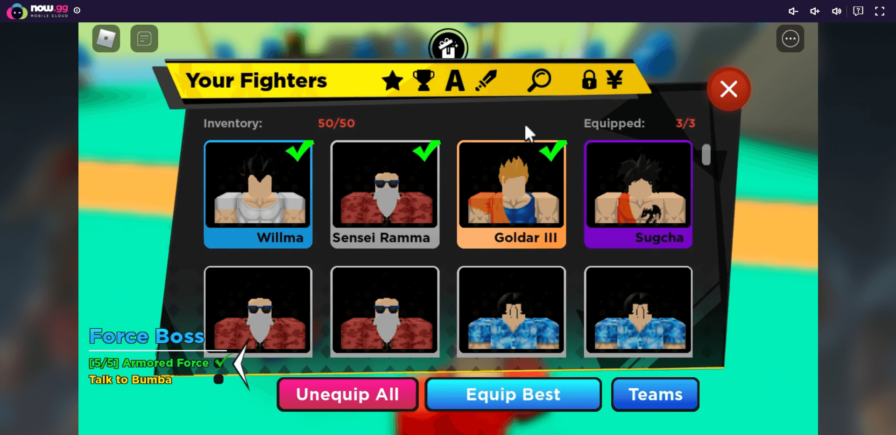
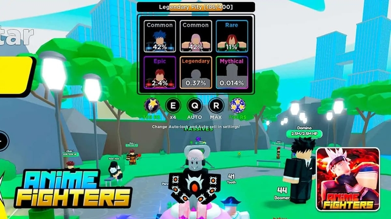
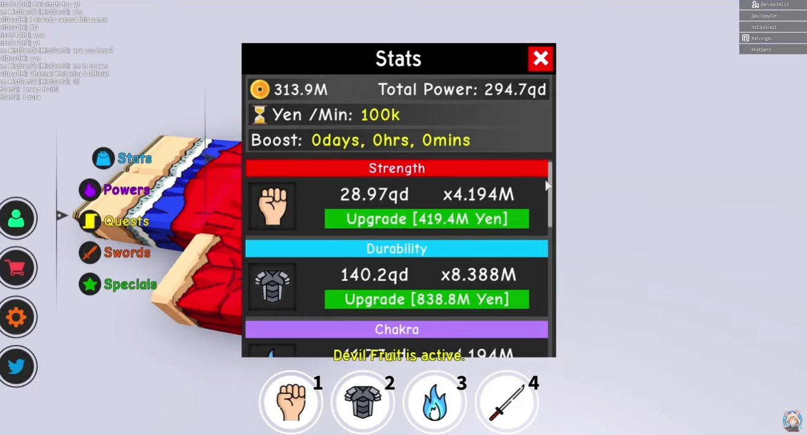
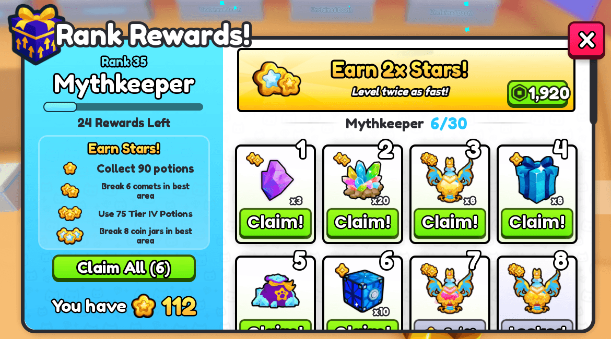
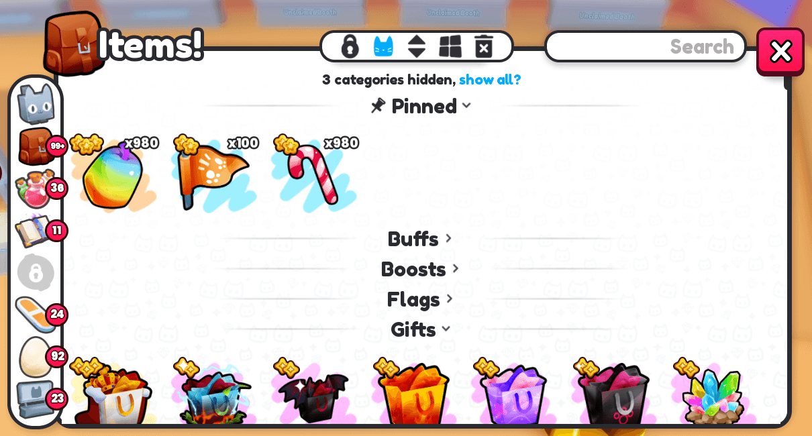
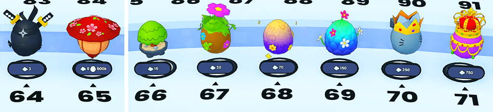
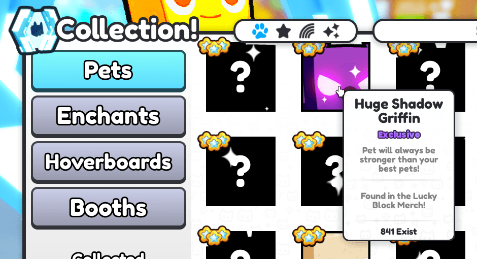

> RESEARCH RECORD — NOT CURRENT IMPLEMENTATION CANON.
> 2026-10-30 Foundation scope is defined by [LIVE_DESIGN](../LIVE_DESIGN.md). Earlier proposals below for Golden, Hatch 3/10, Auto Fight or additional combat zones are DEFERRED/SUPERSEDED. Exact V1: Hatch 1, six pets, three equipped slots; one farm plus personal gate/preview. Reference screenshots are evidence only and must not become in-game art.

Secondary user concepts, preserved for the relevant area only: [Image 1 — Combat HUD](concepts/combat-hud.png), [Image 2 — Egg/Pets](concepts/egg-pets.png), [Image 3 — World progression](concepts/world-progression.png). These images do not override current V1 scope.

# Slay & Loot — 실제 Roblox 시뮬레이터 레퍼런스 조사
조사일: 2026-10-30, Asia/Seoul
상태: 공개자료 기반 RESEARCH + 적용 제안. 구현·Studio 변경 없음.

## 판단
Slay & Loot의 기준 루프는 **서 있는 적을 반복 처치 → Coins와 무기 획득 → 중복 무기 성장·펫 강화 → 처치 속도 상승 → 보이는 다음 구역 해금**으로 잡는다.

판타지 테마는 이 루프를 꾸미는 시각 언어다. 거대한 성, 긴 마을 이동, 던전 매칭 화면이 첫 화면의 주인공이 되어서는 안 된다. 화면에는 지금 때릴 대상, 얻는 보상, 다음에 살 것이 함께 보여야 한다.

근거 우선순위:
1. 확인한 실제 플레이 화면과 개발사 공식 기능/업데이트 자료.
2. 출처가 분명한 기존 플레이 가이드와 커뮤니티 자료.
3. 이번에 첨부된 생성 이미지: 색감·분위기·수집 판타지 참고.

### 조사 한계
직접 게임에 접속하거나 모바일 조작을 시험한 결과가 아니다. 컴퓨터 유스는 사용하지 않았다. 공개 스크린샷과 공식 자료를 비교했다. 아래의 studs, 초, UI 면적, 적 수, 성장 수치는 **Slay & Loot의 검증용 제안값**이며 레퍼런스 게임을 실측한 값이 아니다.

Sword Fighters/Anime Fighters의 상세 화면 중 일부는 2022년 대표 화면이다. 이를 2026년 최신 HUD로 주장하지 않는다. Pet Simulator 99는 2026-10-24 공식 Update 99 자료도 확인했다. 검색에 나오는 이름이 비슷한 재게시 게임·다른 제작자의 복제판은 원작 근거에서 제외했다. Anime Fighters 원작은 Place 6299805723, Sword Fighters는 11040063484다.

## 1. REFERENCE BREAKDOWN

| 레퍼런스 | 확인한 강점 | TAKE | ADAPT | IGNORE |
|---|---|---|---|---|
| **Sword Fighters Simulator — FullSprint Games** | 스윙으로 Power, 적에게서 검, Coins로 펫, Ascend로 성장하는 루프가 공식 설명에 명확하다. 대표 화면에서 스폰 옆 알·퀘스트 NPC와 앞쪽 적 군집이 연결된다. | 전투·검 드롭·펫·구역을 하나의 짧은 성장 루프로 연결. 구역 안의 강도별 고정 적. | 검 수집의 가치를 중복 즉시 성장으로 바꾼다. Auto Swing과 자동 이동/타깃 전환은 구분한다. | 허공 스윙을 장시간 의무화하는 설계, 초기부터 많은 Ascend/이벤트/부가 통화. |
| **Anime Fighters — [B:S] Anime Fighters** | 대표 화면에서 큰 적별 HP, 클릭 대상 지정, 소환 확률표, 희귀도 카드, 장착 체크와 Equip Best가 읽힌다. | 서 있는 타깃을 선택해 반복 전투. 소환 전에 결과 후보 표시. 인벤토리의 Equip Best. | 수집 전투원은 독창적인 펫으로, 주인공 공격은 직접 든 검으로 표현한다. | 보호받는 애니 캐릭터·세계관, 부가 강화 시스템을 한꺼번에 복제, 수동 재료 선별 부담. |
| **Anime Fighting Simulator — 원작/대표 자료** | 훈련 스탯, 배율, 다음 업그레이드 비용이 같은 패널에 있다. 행동별 아이콘이 분리된다. 원작 Place 4042427666은 조사 시 제목/상세가 노출되지 않았다. | 현재 수치 → 배율/효과 → 다음 비용의 명확한 정보 순서. 한 행동당 즉시 숫자 피드백. | 여러 훈련 스탯 대신 무기 ATK와 팀 기여도를 우선한다. | 넓은 훈련장 탐색, 여러 애니 능력·PvP·다중 스탯을 새 게임의 필수 골격으로 삼기. 현재 동명 게임과 원작을 혼동하기. |
| **Pet Simulator 99 / Pet Simulator 계열 — BIG Games** | 알 진열·가격표·수집 인덱스와 변형 구분. 공식 Update 99에서 Claim All, 접히는 분류, 고정 항목, 알림 설정 개선을 확인했다. | 알 → 결과 미리보기 → 일괄 부화 → 팀 정리 → 다음 구역. 미발견 실루엣과 수집 진척. | 수많은 메뉴 대신 작은 메뉴 집합. 펫은 검 파밍을 돕는 역할로 유지. | 수천 종 콘텐츠 규모, 거래 경제, 과한 이벤트 통화·상점·동시 알림을 초기부터 따라 하기. |
| **Weapon Fighting Simulator — Lightning Dragon Studio** | 대표 합성 가이드는 남는 무기를 선택해 레벨/공격력을 높이는 흐름을 설명한다. | 중복에도 성장 가치가 있다는 메시지. 무기 카드의 레벨과 공격력 연결. | 수동 재료 선택·합성 과정을 같은 무기 드롭 시 자동 적립으로 단축. | 여러 부유 무기를 동료처럼 운용하는 전투 정체성, 복잡한 Shiny+ 단계와 합성 메뉴를 그대로 복제. |

근거: [Sword Fighters 공식 페이지](https://www.roblox.com/games/11040063484/Sword-Fighters-Simulator), [Anime Fighters 공식 페이지](https://www.roblox.com/games/6299805723/Anime-Fighters), [Anime Fighters 대표 플레이 가이드](https://now.gg/blog/game-guides/roblox-anime-fighters-simulator-guide-en.html), [Anime Fighting Simulator 원작 페이지](https://www.roblox.com/games/4042427666/Anime-Fighting-Simulator), [Pet Simulator 99 Update 99 — 2026-10-24](https://www.biggames.io/post/pet-simulator-99-update-99), [Weapon Fighting Simulator 합성 가이드 — 2022-04-21](https://progameguides.com/roblox/how-to-fuse-weapons-in-roblox-weapon-fighting-simulator/).

### 실제 화면에서 읽은 문법

**R1 — Sword Fighters: 서비스 앞마당.** 좌측에 통화·성장 수치와 메뉴 묶음, 우측에 Auto Swing 상태, 하단에 짧은 첫 행동 목표가 있다. 알은 건물 내부가 아닌 열린 공간의 받침대 위에 있고 가격이 머리 위에 표시된다. 중앙 큰 보상창 없이 주변을 볼 수 있다.
출처: [GAMEWAVE의 실제 게임 화면](https://gamewave.fr/roblox/roblox-codes-sword-fighters-simulator/). 페이지 갱신일과 화면 촬영일은 같다고 볼 수 없다.

**R2 — Sword Fighters: 첫 전투 구역.** 넓은 길 양옆에 작은 적이 떨어져 서 있고, 더 안쪽에 다른 색·큰 실루엣의 적과 다음 지형이 보인다. 적 배치는 순찰하는 RPG 몬스터 무리보다 반복 선택 가능한 파밍 자리로 읽힌다.
출처: [Player Assist의 2022년 화면](https://playerassist.com/all-sword-fighters-simulator-codesroblox-tested-december-2022/).

**R3 — Anime Fighters: 타깃과 인벤토리.** 적 머리 위에 이름·HP가 있고, 크기가 다른 적들이 같은 장소에서 위계를 만든다. 인벤토리는 수집 용량과 장착 슬롯을 따로 표시하고, 큰 카드·희귀도 테두리·녹색 장착 체크·Equip Best를 사용한다.
출처: [now.gg 대표 가이드와 화면 — 본문은 2022년 맥락](https://now.gg/blog/game-guides/roblox-anime-fighters-simulator-guide-en.html). cloud 서비스 바깥 프레임은 게임 UI로 계산하지 않았다.

**R4 — Anime Fighters: 소환.** 후보 카드, 희귀도, 확률, 소환 조작이 같은 시야에 모인다. 여러 Common 후보가 함께 있으므로 알/소환기 이름과 결과 희귀도가 같은 축일 필요가 없다. 이 화면의 확률과 소환 수량을 Slay & Loot 기본값으로 복제하지 않는다.
출처: [FPT Shop에 게재된 실제 화면](https://fptshop.com.vn/tin-tuc/giai-tri/anime-fighters-simulator-202507). 촬영 버전은 미확인.

**R5 — Anime Fighting Simulator: 수치와 비용.** 같은 행에서 스탯, 배율, Upgrade 비용을 볼 수 있다. 메뉴를 열어야 할 때는 큰 패널을 써도 되지만, 이 상태를 상시 전투 HUD로 삼지 않는다.
출처: [대표 스탯 화면을 게재한 커뮤니티 가이드](https://anime-fighting-simulator.com/guides/devil-fruits-hunting-guide). 촬영 버전/날짜와 원작 현재 서비스 상태는 별도 미확인.

**R6 — Pet Simulator 99: 최신 정리 UX.** 2026-10-24 개발사 화면에 Claim All과 접힌 카테고리/고정 항목이 보인다. 밝은 큰 아이콘·두꺼운 글자 외에도, 반복 관리 횟수를 줄이는 것이 중요한 문법이다.
출처: [BIG Games Update 99](https://www.biggames.io/post/pet-simulator-99-update-99).

**R7 — Pet Simulator 99: 알과 인덱스.** 개발사의 초기 업데이트 이미지에서 알 받침대 바로 아래 가격, 미발견 실루엣과 변형 탭이 보인다. 이 그림은 기능을 설명하는 개발사 이미지이며 전체 gameplay HUD 캡처가 아니다.
출처: [BIG Games Update 1 — 2023-12-09](https://www.biggames.io/post/pet-simulator-99-update-1).

## 2. SLAY & LOOT VISUAL LANGUAGE

**밝고 두꺼우며 수집품이 먼저 읽히는 판타지 시뮬레이터.**

- 지형: 큰 잔디 면, 단순한 절벽 단면, 굵은 길, 큰 나무·바위 몇 개. 정교한 성벽 벽돌보다 타깃과 게이트의 구분이 우선.
- 검: 손에 든 주인공 수집품. 카드 아이콘과 실제 장착 모델의 실루엣이 일치해야 한다.
- 펫: 작은 몸·큰 얼굴·명확한 외곽선. 기본 팀은 전투를 가리지 않게 플레이어 뒤/옆에 배치한다.
- 일반 적은 바탕색과 대비, 강적은 추가 갑옷/체격, 미니보스는 고유 윤곽, 보스는 멀리서 보이는 큰 랜드마크로 구분.
- UI: 굵은 제목, 밝은 숫자, 어두운 외곽선, 넓은 누름 영역, 단순한 아이콘과 짧은 영어 라벨.
- 한 화면의 밝은 강조점은 타깃·드롭·다음 게이트로 제한. 모든 건물·펫·검을 동시에 네온으로 만들지 않는다.
- VFX 단계: 일반 타격은 작게, 레벨 상승은 중간, 최초 고희귀도 발견은 가장 강하게. 화면 흔들림·섬광은 줄일 수 있어야 한다.

희귀도는 색+문자+프레임 기호로 표시한다.

| Rarity | 기본색 제안 | 추가 표기 |
|---|---|---|
| Common | 회색 | 얇은 테두리 |
| Uncommon | 녹색 | 작은 보석 1개 |
| Rare | 파랑 | 분명한 보석 프레임 |
| Epic | 보라 | 별/강한 프레임 |
| Legendary | 금색 | 왕관/짧은 광선 |
| Mythic | 붉은 자홍 | 고유 문양/제한된 오라 |

색만으로 희귀도를 설명하지 않는다. 초록은 버튼에도 쓰이므로 아이템에는 반드시 Rarity 이름을 붙인다. 이 팔레트와 문양은 자체 제작하며 타 게임 UI 자산을 가져오지 않는다.

## 3. SLAY & LOOT UI GRAMMAR

레퍼런스들의 통화 위치는 일치하지 않는다. 공통점은 **현재 자원과 반복 조작은 화면 가장자리, 타깃과 다음 목표는 월드 시야 안**에 있다는 것이다. 아래 배치는 Slay & Loot의 일관된 선택이다.

| 요소 | 제안 위치/동작 |
|---|---|
| Coins | 상단 좌측~중앙의 고정 카운터. 아이콘·값·증가 피드백. 초기 핵심 지출 통화 1개로 시작. |
| Gems | 실제 사용처가 생길 때 두 번째 카운터로 추가. 장식용 0 Gems와 구매 + 버튼을 먼저 채우지 않음. |
| Power / Damage | 돈과 구분한 읽기 전용 전투 수치. 통화처럼 지출되는 아이콘/구매 +를 붙이지 않음. |
| 주요 메뉴 | 좌측 Weapons / Pets / Quests / Rewards. Index·Shop·Settings는 하위 묶음 또는 작은 아이콘. |
| 알림 배지 | 받을 보상, 새 미확인 아이템 등 실제 할 일이 있을 때만 숫자. 모든 메뉴에 상시 빨간 ! 금지. |
| Boost | 우측 작은 아이콘+배율+남은 시간. 활성 부스트만 표시하고 여러 개는 접을 수 있게. |
| 다음 목표 | 우측 상단 한 장: Next Zone, 필요한 Coins, 현재 진척. 이동 지점은 월드 게이트에도 표시. |
| 적 HP | 가까운 적 머리 위. 비타깃은 축약, 선택 타깃은 이름/종류/현재·최대 HP를 강조. |
| 보스 HP | 보스 전투 중에만 상단 중앙 긴 막대. 일반 적 HP와 거대한 전역 막대를 중복 표시하지 않음. |
| 피해 숫자 | 타깃 위로 짧게 떠오름. 펫 다중 타격은 합산/묶음. 다른 플레이어 숫자는 축소/숨김 가능. |
| 공격 | 데스크톱 LMB와 단일 Attack 버튼. 하드웨어 단축키를 아이콘에 영구 인쇄하지 않음. |
| Auto Fight | 공격 근처에 ON/OFF와 현재 대상 상태. 초록색만으로 ON을 표현하지 않음. |
| 드롭 | 중앙 아래 한 자리의 비차단 카드. 일반 중복은 더 작은 토스트로 묶음. |
| 레벨 상승 | 같은 드롭 카드를 확장/변환. 플레이어/무기/펫 레벨 중 무엇인지 제목에 명시. |
| 인벤토리 | 열었을 때 큰 카드 그리드, 검색, 정렬, 장착 상태. Weapons와 Pets 탭을 분명히 분리. |
| 보상 화면 | Claim All, 새 보상 표시, 미수령 수. 전투 중 매번 자동으로 전체 창을 열지 않음. |

### 알림 우선순위
1. 첫 고희귀도 발견.
2. 무기 레벨 상승.
3. 새로운 일반 무기.
4. 일반 중복/Coins/XP.

같은 이벤트의 희귀 드롭+레벨 상승은 한 카드에 합친다. 일반 중복 5개는 같은 무기 토스트에 ×5로 누적한다. 동일 시점에 좌우 거대 창을 열지 않는다. 세션 알림 기록에서 놓친 획득품을 확인할 수 있게 한다.

표시 시간 시작안: 일반 중복 0.8~1.2초, 새 일반 무기 1.5초, 레벨 상승 1.5~2초, 최초 고희귀도 발견 2~3초. 같은 종류를 연속 획득하면 카드를 다시 열지 않고 내용과 수량을 갱신한다. 위 시간도 자체 제안이며 실제 게임에서 측정한 값이 아니다.

### 모바일 기준 — 아직 기기 검증 전
- 가로형을 첫 기준으로 잡고 844×390, 1280×720, 1920×1080에서 확인.
- 기본 터치 영역 48×48 논리 픽셀 이상을 검증 시작점으로 사용.
- 좌측 이동 스틱과 우측 Roblox 점프 영역은 예약. Attack/Auto Fight는 그 영역과 겹치지 않는 별도 위치.
- 좌측 메뉴는 3~4개 핵심 버튼과 More로 축소. 세로 이벤트 패널 여러 장을 그대로 축소하지 않음.
- 전투 중 상시 불투명 UI는 화면 면적 약 20~25% 이하를 목표로 하고, 중앙 가로 60% × 세로 55%에는 고정 패널을 두지 않음.
- 숫자는 1.2K / 3.4M처럼 일관되게 축약하고 상세 값은 패널/선택으로 제공.
- hover가 필요한 설명은 탭으로도 볼 수 있어야 함.
- 부화·인벤토리·큰 보상 화면을 열면 공격 입력이 뒤 월드로 전달되지 않아야 함.

BIG Games가 Update 1에서 모바일 boost 아이콘 겹침을 줄였다고 기록한 점도, PC 좌우 패널을 단순 축소하는 방법의 한계를 보여준다. [공식 근거](https://www.biggames.io/post/pet-simulator-99-update-1)

## 4. SLAY & LOOT WORLD GRAMMAR

### 연결 구조
**작은 안전 앞마당 → 바로 보이는 파밍 구역 → 가격이 적힌 게이트 → 대비되는 다음 생태계.**

- 스폰에서 첫 적, 첫 알, 다음 게이트 방향이 동시에 이해되어야 한다.
- 알과 장비 관리는 전투 구역 입구 옆 안전한 가장자리에 둔다. 매번 큰 마을 중앙까지 왕복하지 않음.
- 각 구역은 중앙 이동길, 양옆 파밍 자리, 뒤/옆의 강적 자리, 전방 게이트로 구성.
- 다음 구역의 대표 나무·색·큰 적 실루엣이 잠금 상태에서도 보여야 한다.
- 평탄한 바닥과 짧은 경사로 사용. 좁은 다리, 깊은 낙차, 긴 계단이 필수 동선을 점유하지 않음.
- 일반 구역 게이트는 Coins 가격 한 가지로 먼저 통일. Lv 또는 Coins 같은 선택 조건은 피함.
- 월드 최종 보스는 다음 월드의 상징적 문지기. 일반 구역의 문마다 의무 보스를 둘 필요는 없다.
- 월드 이동은 목적지 이름·새 테마·준비 상태가 있는 전용 포털/메뉴로 구분. 구역 문과 같은 작은 문처럼 보이지 않게.
- 한 월드의 여러 구역을 발전시킬 수 있지만 첫 검증은 안전 앞마당+첫 파밍 구역+해금 가능한 다음 구역으로 제한.

### 공간과 첫 세션의 검증용 목표
기존 삭제된 Hub 크기에 맞추지 않는다. 다음 값은 새 검증용 블록아웃 시작점이다.

| 항목 | 제안값 |
|---|---|
| 안전 앞마당 | 약 48~64 × 48~64 studs |
| 첫 파밍 구역 | 약 80~104 × 64~88 studs |
| 스폰→첫 적 | 약 24~40 studs; 기본 WalkSpeed 16을 가정하면 직선 이동 약 1.5~2.5초 |
| 서비스까지 이동 | 전투 입구에서 대략 2~5초 |
| 주 이동길 | 폭 16~20 studs, 적 스폰/기둥은 길 밖 |
| 서비스 앞 여유 | 폭 10~12 studs 이상의 접근 공간 |
| 첫 처치 | 조작을 시작한 뒤 약 5~12초 |
| 첫 새 무기 | 약 10~25초 안에 체험하도록 드롭/첫 보상을 설계 |
| 첫 중복 성장 | 약 30~60초 안에 체험 |
| 첫 펫 | 약 45~90초 안에 부화 또는 초기 보상으로 체험 |
| 첫 구역 해금 | 약 3~5분, 검증 후 조정 |

게이트 거리는 이미지에서 추측하지 않는다. 적을 잡는 시간이 지출 목표로 이어지는지와, 돌아다니기만 하는 공백이 없는지를 플레이로 판단한다. 위 시간은 확률만 믿고 달성되는 값이 아니라 첫 경험 보호/안내를 포함한 제품 목표다.

### Map art와 외부 에셋
생성 이미지에서 숲·폭포·돌담·큰 성의 밝은 판타지 분위기는 가져올 수 있다. 섬 여섯 개와 다리, 모든 단계의 성을 그대로 짓지는 않는다.

검토된 외부 환경 모듈·무기 모델·펫 모델·아이콘·VFX·SFX를 적극 사용한다. 사용 전 출처/라이선스, 포함 스크립트, 실제 크기·피벗·충돌·카메라 가림·반복 배치 성능을 확인한다. 팩 전체가 아니라 필요한 모듈만 추출하고 색·재질·디테일 밀도를 통일한다. 작은 바위·풀은 길 가장자리, 큰 성·폭포는 배경에 둔다.

## 5. SLAY & LOOT ENEMY PLACEMENT GRAMMAR

적은 **이동 중 우연히 만나는 순찰 몬스터**보다 **다시 방문해 선택하는 파밍 타깃**으로 배치한다.

| 등급 | 위치·배치 | 시각 정보 | 검증 시작점 |
|---|---|---|---|
| Normal | 입구 가까운 양옆 3~4개 묶음. 각 개체는 떨어져 서 있음 | 짧은 이름·작은 HP, 기본 실루엣 | 한 구역 10~14자리, 중심 간 14~18 studs |
| Strong | 중앙~뒤쪽, Normal과 다른 얕은 포켓 | 갑옷/무기/체격 변화, Strong 라벨 | 3~4자리, 중심 간 18~24 studs |
| Mini-Boss | 옆의 작은 원형 터. 일반 타깃보다 한눈에 특별함 | 고유 윤곽, 큰 HP, Mini-Boss 라벨 | 1자리, 주변 20~28 studs 정도 확보 |
| World Boss | 월드 끝의 큰 랜드마크, 구역 입구에서도 방향 인지 | 고유 모델·전용 이름·보스 HP | 1개 전용 공간, 둘레 카메라와 동시 접근 검증 |

- 위 적 수는 첫 구역에 약 8명의 동시 파밍을 가정한 시작점이다. 실제 서버 정원과 처치 속도에 맞춰 조정한다.
- 적은 이름 붙인 스폰 자리에 재등장. 기본 대기 상태는 그 자리를 유지하고, 반응 이동을 써도 원래 자리 근처로 제한.
- 중앙 길 한가운데 타깃을 세워 통과하는 플레이어를 막지 않는다.
- 같은 적을 여러 플레이어가 공격할 수 있고, 보상은 참여자별로 판단. 마지막 타격을 뺏긴 사람이 보상을 잃는 경쟁을 기본으로 삼지 않음.
- 일반 적 재등장 시작점은 약 3~5초. 표적 부족/오래 기다림/즉시 증발을 함께 측정한다. 보스 재등장은 별도 표시.
- 자동 공격은 선택 대상을 우선한다. 수동 클릭은 자동 선택을 덮어쓴다.
- Auto Fight는 현재 열린 구역의 가까운 일반/강적을 순서대로 선택. 다음 게이트를 결제하거나 다른 구역·보스에게 임의로 넘어가지 않음.
- 선택 링·살짝 강화된 외곽선·화면의 대상 이름으로 누구를 때리는지 알게 한다. 펫도 같은 타깃을 공격.
- 비타깃 HP와 다른 플레이어 펫/VFX를 축소할 수 있게 하되, 적의 강도 실루엣은 남긴다.
- 일반 적은 플레이어 키와 비슷하게, 강적/미니보스/월드 보스는 순차적으로 키·가로폭·고유 장비를 키운다. 크기만 확대해 카메라를 막는 모델은 피한다.

## 6. SLAY & LOOT PET / EGG GRAMMAR

### 표준 흐름
**알 받침대 → 가격·후보·확률 → Hatch 1 / 3 / 10 → 부화 결과 → Equip Best → 파밍.**

1. 알은 구역 테마 이름을 쓴다. 예: Meadow Egg. Common Egg / Rare Egg처럼 알 이름과 결과 희귀도를 혼동시키는 체계를 기본으로 쓰지 않는다.
2. 받침대에 알 하나와 실제 통화 아이콘+가격. 가까이 가면 후보 펫 카드·희귀도·확률·발견 여부를 한 패널에서 본다.
3. Hatch 1 / Hatch 3 / Hatch 10 각각에 **전체 결제 가격**을 표시. 기본은 단가×수량이며 할인은 명시적으로 있을 때만.
4. 3/10 부화는 해금되어 사용할 수 있을 때 제공하고, 잠겨 있다면 해금 조건을 명확히 표시한다. 레퍼런스들의 수량은 서로 달라 1/3/10을 업계 공통 숫자라고 주장하지 않는다.
5. Auto Hatch는 선택 수량을 반복. Stop은 항상 보인다. Coins 부족·수용 공간 부족·서비스 영역 이탈에는 이유를 표시하고 멈춘다.
6. 결과는 펫 모델/아이콘, 이름, rarity, 효과, NEW 여부. 10마리면 하나의 결과 그리드로 묶고 일일이 Continue를 요구하지 않는다.
7. Pets 패널: Equipped 3/3과 Storage 24/100을 분리. 검색·강함순·희귀도 필터·Lock·Equip Best·Unequip All.
8. Equip Best는 현재 실효 전투 기여도로 비교하고 팀 슬롯 수만큼 장착한다. 변형/레벨까지 반영하며 색 순서만으로 선정하지 않음.
9. Auto Delete는 rarity별 명시적 ON/OFF. 초기값 전부 OFF. 최초 발견, 잠긴 펫, 장착 펫, 높은 희귀도 보호를 분명히 한다. ‘획득 후 자동 정리됨’을 결과에 표시하고 Index 발견 기록은 보존.
10. Index는 발견/전체 수, 실루엣, 획득 위치, 변형 탭. 초기 메인 목표를 가리지 않는 보조 수집 화면.

### 희귀도와 변형은 다른 축
- Rarity: Common → Uncommon → Rare → Epic → Legendary → Mythic.
- Variant: Normal → Golden → Rainbow.
- Shiny: 별도 반짝임/특수 변형으로 설명. ‘Mythic보다 다음 등급’으로 섞지 않는다.
- 펫 레벨을 추가한다면 위 두 축과 분리해 카드에 표시한다.

DEFERRED RESEARCH PROPOSAL: 아래 Golden/Rainbow 내용은 후속 후보이며 현재 V1에서는 구현하지 않는다. 과거 조사 시 제안했던 내용: 합성은 **같은 펫 5마리 → Golden 1마리, 성공 100%**를 시작안으로 둔다. Rainbow를 추가할 경우 **같은 Golden 5마리 → Rainbow 1마리**처럼 비용을 그대로 예고한다. 이 비율은 자체 제안이며 타 게임의 현행 합성 비율이 아니다. 장착/잠긴 펫은 기본 재료에서 제외하고, 소비와 결과를 확정 전에 보여준다.

펫 수집은 익숙하게 유지하되, 전투 효율 향상이 실제 검 파밍으로 돌아와야 한다. 펫 관리만 계속하고 무기 드롭을 보지 못하는 첫 세션을 피한다.

## 7. SLAY & LOOT WEAPON-DROP GRAMMAR

### 핵심 계약
**같은 weapon definition의 보유 레코드는 하나. 같은 검을 다시 얻으면 그 검의 Duplicate XP가 즉시 증가한다.**

‘같은 검’은 같은 아이콘/이름이 아니라 같은 고정 무기 종류를 뜻한다. 첫 버전에서는 rarity와 기본 스탯을 무기 종류에 고정하고 랜덤 affix/별도 품질/무기 variant를 섞지 않는다. 미장착 무기도 중복으로 성장한다. ‘새 인벤토리 슬롯 생성 → 나중에 합성’ 단계가 없다.

### 성장 시작안
- 새 무기: Lv.1, Duplicate XP 0.
- 같은 검 1개: Duplicate XP +1.
- Lv.1→2는 1개로 즉시 체험.
- 이후 레벨별 필요 중복 수 시작안: 2 / 3 / 5 / 8 / 12 / 18 / 27 / 40.
- 첫 임시 상한 Lv.10. 초과 XP는 다음 단계로 이월, 일괄 드롭도 한 번에 처리.
- 공격력 시작안: Base ATK × [1 + 0.20 × (Level−1)]. Lv.2는 기본 대비 +20%, Lv.10은 ×2.8. 이는 최종 밸런스가 아님.
- 일반적인 신규 구역 검과 이전 구역 최고 레벨 검을 비교해, 새 무기도 성장한 오래된 무기도 의미가 있게 조정.
- 같은 검을 장착 중이면 상승한 공격력이 즉시 반영되고, 같은 실루엣의 광택/디테일만 단계적으로 강화.
- 상한 도달 후의 중복 보상과 전환 Coins 값은 상한에 도달하기 전에도 상세 패널에서 예고한다.
- 일괄 획득 도중 MAX가 되면 상한까지 필요한 개수만 XP로 사용하고 나머지 개수는 각각 Coins로 전환한다. 예: MAX까지 1개 남은 상태에서 같은 검 5개 획득 → MAX 도달 + 초과 4개분 Coins. 초과분이 사라지지 않는다.

| 상태 | 영어 피드백 예시 | UX / 결과 |
|---|---|---|
| **NEW WEAPON** | NEW WEAPON · Thornblade · Rare · ATK 100 | 카드 한 장과 짧은 모델 회전, Index 발견 기록. 강해지면 Equip 표시. 입력을 막지 않음. |
| **DUPLICATE** | DUPLICATE → +1 Weapon XP · 1/3 → 2/3 | 기존 썸네일에 작은 +1과 채워지는 막대. 새 카드 슬롯을 만들지 않음. 반복 드롭은 같은 토스트에 누적. |
| **WEAPON LEVEL UP** | WEAPON LEVEL UP! · Lv.2 → Lv.3 · ATK 120 → 140 | 중복 토스트가 상승 카드로 바뀜. 같은 검 전/후를 보여줌. 첫 레벨 상승은 조금 크게, 이후는 짧게. |
| **MAX LEVEL 도달** | MAX LEVEL! · Lv.10 · ATK 280 | 최고 단계 도달을 한 번 강조. 이후 카드에는 MAX 배지와 최종 공격력. 더 받을 XP 막대를 남기지 않음. |
| **MAX 이후 중복** | DUPLICATE · MAX LEVEL · +250 Coins | 같은 검 전용 고정 Coins 보상으로 즉시 전환. 250은 UI 예시이며 실제 값은 무기 표에서 정함. 버려지거나 새 슬롯이 생기지 않음. |
| **RARE DROP** | LEGENDARY! · [Weapon Name] · NEW 또는 +1 Weapon XP | 희귀도는 위 모든 상태에 적용되는 강조 축. 최초 고희귀도 발견에 가장 큰 연출. 고희귀도 중복도 실제 XP/레벨 결과를 함께 보여줌. |

### 카드·인벤토리 규칙
- Weapons 그리드에 종류당 카드 하나: 무기 이미지, rarity, Lv., 다음 레벨 진척, 현재 ATK, 장착 체크.
- 상세 패널: 현재 ATK, 다음 레벨 ATK, 필요한 같은 검 수, 주 드롭 적/구역.
- Equip Best는 **현재 레벨의 실제 전투 성능**으로 선택. 고희귀도 Lv.1이 저희귀도 고레벨보다 무조건 위라고 판단하지 않음.
- 직접 선택한 장비가 마음대로 바뀌지 않게 Auto Equip Better는 별도 선택. 처음으로 더 강한 검을 얻었을 때 작은 Equip 안내로 첫 성공을 만든다.
- 두 번 도착한 같은 보상 알림이 XP를 두 번 올리지 않도록 실제 획득 결과와 표시를 일치시켜야 한다. 구체 구현은 후속 설계.
- 같은 검이 한 번에 여러 개 나오면 +N Weapon XP, 몇 레벨 상승했는지, 남은 진척을 한 카드로 요약.
- 일반 중복, Coins, Level Up이 동시에 생기면 한 획득 사건으로 묶는다. 모든 드롭에 확인 버튼·전체 화면·서버 전체 공지를 붙이지 않음.
- 보상은 참여자에게 즉시 귀속. 월드에 떨어지는 검/Coins의 짧은 연출은 획득을 보여주는 표현이며, 돌아가서 주워야 하거나 다른 사람이 가져가는 별도 아이템이 아니다. 고희귀도 광선도 해당 획득자의 시야를 우선한다.

Weapon Fighting Simulator의 기존 합성은 “남는 무기를 재료로 선택”하는 흐름이다. Slay & Loot의 **같은 종류 즉시 성장** 규칙은 사용자 요청을 반영한 차별점이며 레퍼런스의 현행 동작이라고 설명하지 않는다.

## 8. 첨부 생성 이미지 적용/수정표

| 이미지 | 가져올 것 | 실제 게임 기준으로 바꿀 것 |
|---|---|---|
| 1. 전투 HUD | 검·펫·적의 밝은 대비, 명확한 희귀도, 다음 구역 목표 | 두 개의 거대 드롭/레벨업 창을 한 알림 자리로 통합. 우측 부스트/이벤트는 축약. 화면을 가득 채운 이펙트 감소. |
| 2. 알/펫 보드 | 알 받침대·가격·후보 카드·Equip Best·자동 정리라는 익숙한 문법 | 희귀도별 알 여섯 개 대신 구역 테마 알과 혼합 결과. 가격/확률은 새 경제 검증으로 결정. 그림의 1/3/10 할인 비율 복제 금지. |
| 3. 월드 보드 | 구역별 색/생태계 상승, 잠긴 미래 지역, 큰 마지막 보스 | 여섯 절벽 섬과 다리를 설계도로 쓰지 않음. 서비스와 적을 가까이, 연결 통로는 넓고 평탄하게. Lv 또는 Coins 조건을 단순화. |

## 9. 구현 전에 확인할 관문
이 문서는 조사와 시작 규칙까지다. Studio 작업, 게임 코드, 최종 HUD, 맵을 만들지 않았다.

다음 실험은 첫 적·검 NEW/중복/레벨업·알 1종·다음 게이트를 연결한 작은 흐름이어야 한다. 그때 확인할 것은:
- 첫 화면에서 적과 다음 목표를 설명 없이 찾는가.
- 중복을 주웠을 때 “같은 검이 강해졌다”를 이해하는가.
- 모바일에서 공격·이동·점프와 메뉴가 충돌하지 않는가.
- 일반 보상 20회가 시야를 가리지 않는가.
- 여러 플레이어가 같은 구역을 공유해도 적과 보상이 부족하지 않은가.
- 부화 1/3/10, Auto Hatch 중지, Equip Best, Auto Delete 보호가 이해되는가.
- 첫 업그레이드 뒤 처치 속도가 실제로 빨라지는가.

### 남아 있는 검증 공백
각 게임의 최신 전체 HUD, 정확한 거리·경로 폭·재등장 초·현재 모바일 배치, 실제 여러 플레이어의 보상 소유 규칙은 이번 공개자료만으로 실측하지 못했다. 이를 이미 확인한 사실처럼 사용하지 않는다. 자동 전투, 보상 소유권, 속도·규모·시간·경제는 위의 제안을 실제 플레이로 검증해야 한다.

## 출처 지도
- 게임 식별/핵심 루프: Roblox의 제작자별 공식 게임 페이지.
- 실제 대표 화면: GAMEWAVE, Player Assist(2022), now.gg(2022), FPT Shop, 명시한 커뮤니티 가이드.
- 최신 관리 UX: BIG Games Update 99(2026-10-24).
- 알·인덱스·모바일 겹침 수정의 역사적 근거: BIG Games Update 1(2023-12-09).
- 수동 무기 합성 비교: Pro Game Guides(2022-04-21).
- 보조 확인: [Sword Fighters 퀘스트 자료](https://sword-fighters-simulator.fandom.com/wiki/Quests), [Weapon Fighting Simulator 무기 자료](https://weapon-fighting-sim.fandom.com/wiki/Weapons).
- 로컬 image-sources.json: 실제 열어 확인한 공개 이미지의 원본 URL.
- 익스플로잇/스크립트 배포 사이트, 계정·아이템 거래 사이트는 정상 기능의 근거로 사용하지 않음.
